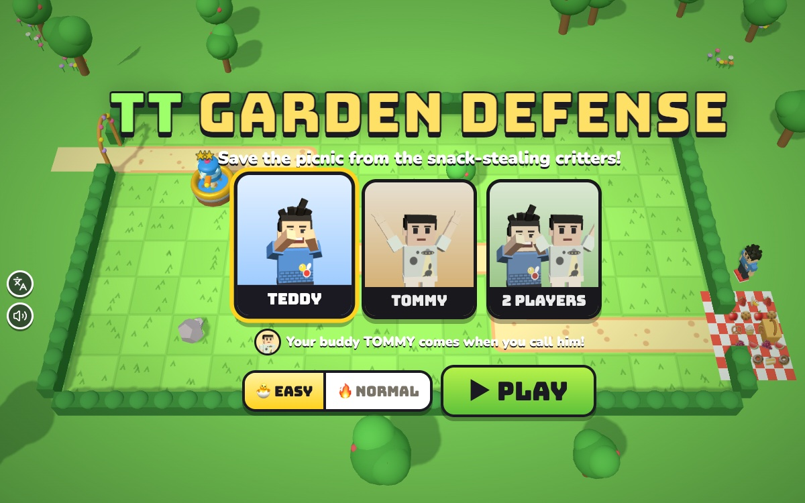

# TT Garden Defense

[](https://adong.github.io/garden-defense-tt/)

Press **?** any time (or tap the round **?** button on the left edge) to see the keys. The game waits while you look.
Tap the language button under it (the A文 icon) to switch between English and 中文; the dashboard and every game remember the choice.

**中文：** 花园保卫战：在小路旁边放玩具塔（喷水、泡泡、果冻、饼干投石、洒水），给塔升级，挡住一波次又一波次偷零食的小动物，还可以叫兄弟扔超大水气球来帮忙。

A tower-defense game starring Teddy and Tommy. Silly snack-stealing critters march along the garden paths toward the picnic; Teddy and Tommy put toy towers on the grass beside the path and upgrade them. Nobody ever gets hurt: the critters get soaked or sleepy, a bubble closes round them and they float away, and each one leaves a coin. 15 gardens in 3 worlds, with waves, coins and stars. It's built with Claude Code from plain JavaScript and Three.js, in the same style as Metro Surfer and the other Teddy & Tommy games. There are no image, model or audio files: the garden, the towers and the critters are boxes, spheres and canvas-painted textures, the characters come from the shared kit (`kit/`), and every sound is synthesised.

The name lives in one place, [js/title.js](js/title.js). "TT Garden Defense" is a working title until Alan names it.

## Play

- **Double-click `index.html`.** It works offline, because Three.js and the kit are copied into `kit/`. Without internet the logo falls back from the Bungee font to Arial Black.
- **Send one file:** `dist/garden-defense-tt.html` is the whole game in one file. AirDrop or email it, then open it in a browser.
- **Rebuild that file** after any edit: `python3 kit/tools/bundle.py . --name garden-defense-tt`
- **Get kit updates** from `~/claude-games/kit`: `python3 ../kit/tools/sync.py .`, then rebuild.
- **Saved per browser** (`gardenDefenseTT.v1`): who's playing (Teddy, Tommy or 2 players), each one's EASY / NORMAL, and each one's stars and best score in every garden. A garden opens when the one before it has a star; `?all` in the address opens them all.

### How it plays

1. Tap the grass next to the path. A menu pops up with the five towers and their prices; tap one to build it.
2. Tap a tower to upgrade it (⬆, up to ★★★: bigger, faster, further) or pack it up (🧺): all the coins back in the first 6 seconds (oops!), 70 % after that.
3. The first wave comes by itself after a short countdown, or tap **▶ GO!** to send it now. Between waves there's another countdown; going early gives a coin for every second left. **NEXT WAVE** shows who's coming.
4. Critters that reach the picnic grab a snack and run off giggling. Keep at least one snack to win. ⭐⭐⭐ for every snack left, ⭐⭐ for most of them, ⭐ for any win.

| Tower | Price | What it does |
|---|---|---|
| 💦 Water Squirter | 50 | quick squirts at one critter |
| 🫧 Bubble Blower | 70 | big bubbles: a few critters get sleepy at once |
| 🍮 Jelly Slower | 60 | lobs sticky jelly onto the path; critters on it slow down (bees fly over it) |
| 🍪 Cookie Catapult | 100 | throws giant cookies a long way; the crumbs make everyone near full and sleepy |
| ⛲ Sprinkler | 80 | sprays everyone close by, all at once |

| Critter | |
|---|---|
| Crumb Mouse | the usual snack thief |
| Ant Gang | tiny, and lots of them (sprinklers and bubbles love them) |
| Zippy Squirrel | fast |
| Slowpoke Snail | slow, but takes a lot of water |
| Buzzy Bee | flies, so jelly doesn't stop it |
| Bandit Raccoon | the boss: a big masked raccoon with a crown and a sack; takes 5 snacks if he gets there |

### Gardens

| World | Gardens | |
|---|---|---|
| 🌞 Sunny Backyard | 1–5 | one gate; mice, ants, squirrels, snails; the first Bandit Raccoon in 5 |
| 🌷 Flower Garden | 6–10 | two gates whose paths meet, bees, two bandits in 10 |
| 🌙 Moonlit Veggie Patch | 11–15 | dusk light and fireflies, long paths, bandits in every garden, three in the last wave of 15 |

The maps are 14 × 8 grids of letters in [js/levels.js](js/levels.js), and the waves are short strings like `'mouse x8 /1.2 +3 @1'` (8 mice, one every 1.2 s, starting 3 s in, from gate 1). Critters find their own way from each gate to the picnic (a breadth-first search over the path cells). All the tower and critter numbers are in [js/units.js](js/units.js).

### How hard

| | 🐣 EASY (for Tommy, the default) | 🔥 NORMAL (for Teddy) |
|---|---|---|
| critters | half as soggy-proof, a bit slower | full strength |
| coins at the start | 40 % more | the garden's own amount |
| snacks | 20 | 12 |
| countdowns | 25 s before the first wave, 9 s between waves | 18 s, 7 s |
| help | a ✨ sparkle on a good spot for the next tower (the autopilot's idea), and slow motion while a build menu is open | none |

On the result screen after a NORMAL loss there's a **🐣 TRY EASY** button.

### 2 players

Pick **2 PLAYERS** on the title. Teddy and Tommy share the garden and the coins: Teddy uses `W A S D` and `Space`, Tommy the arrows and `Enter`, each with his own coloured box and his own menu (on a touch screen anyone can tap). The buddy button becomes **✋ HIGH FIVE!** (or `T`): they turn to each other and slap hands (+5 coins, at most every 15 s).

### Winning

The brothers hop onto the picnic blanket and do their signature moves with confetti (Teddy: boxing, then a jump shot with a 🏀; Tommy: his Y with peace fingers), then the result card with the stars, how many critters floated away, the score and the best score (with NEW BEST!), and **NEXT ▶**, **↻ PLAY AGAIN** and **GARDENS**.

## Controls

| Mouse / touch | Keys (player 1) | Keys (player 2) | |
|---|---|---|---|
| tap the grass | move the box `W A S D`, then `Space` | `←` `↑` `→` `↓`, then `Enter` | open the build menu there |
| tap a tower button | `A` `D` to pick, `Space` | `←` `→`, `Enter` | build it |
| | `1`–`5` | | build that tower right away at the box |
| tap a tower | `Space` on it, or `U` | `Enter` on it | upgrade / pack up |
| tap elsewhere, or ✕ | `Q` | `Backspace` | close the menu |
| ▶ GO! | `G` | | next wave now |
| ⏩ | `F` | | fast (2×) |
| the face at the top | `T` | `T` | call your brother; 2 players: a high five |
| ❚❚ | `P` / `Esc` | | pause |
| 🔊 | `M` | | sound on/off (the same switch as every game) |
| title: the cards, EASY / NORMAL, ▶ PLAY | `←` `→`, `E`, `Enter` | | |

On a phone held upright the garden turns on its side (the gates at the top, the picnic at the bottom) and the arrow keys turn with it.

## Your brother, the companion

1 player: tap his face in the top bar or press **T**, any time, as often as you like. The other brother comes (Tommy for everyone, Teddy when Tommy is playing, from `Kit.roster.buddyFor`):

- He pops in beside the picnic blanket at his buddy size (`buddyScale`), with a sparkle, and does his signature move: Tommy's Y, Teddy's boxing ("TOMMY IS HERE!").
- He tosses you a treat (🍦 💧 🧃 🍪 🍉 🍌): it lands on you with a hop and, at most every 12 s, a few coins (+15 on EASY, +10 on NORMAL).
- **Then the helper: a giant water balloon clears one lane.** "TOMMY SAYS: SPLASH TIME!" He lifts a huge blue water balloon over his head and throws it at the lane with the most critters on it (nearest the picnic counting most). It lands with a SPLASH! all the way along that lane, and every critter on it floats away in a bubble (coins as usual). A Bandit Raccoon only gets half soaked.
- He waves and pops out after about 5 s. Calling him again while he's there gets another treat right away and another balloon after this one.

The autopilot in the checks never calls him, so every garden is winnable without him.

## How it was checked

**Headless:** `node tools/check.js` runs `js/sim.js`, `js/bot.js` and `js/check.js` (the same files the page uses) without a browser. All pass in about 5 s (`-v` prints the details):

- **Every garden is winnable by an autopilot on EASY:** a player who builds and upgrades where it helps most (`js/bot.js`), thinking every 0.3 s, every 1 s and every 2.5 s, wins all 15 gardens on EASY, with full snacks. Every autopilot game also checks that its towers are all on grass and that no critter ever leaves the path. For information: the same autopilot also wins all 15 on NORMAL, a clumsy player who builds random towers on random grass next to the path wins 11–12 of 12 tries per garden on EASY (and 0–9 of 12 on NORMAL), and nobody building anything loses every garden on EASY (that one is required).
- **Towers never go on the path:** every cell of every garden: building works on grass and only grass (never on the path, the gates, the picnic, trees, rocks, ponds or flower beds), no coins go on a tower that wasn't built, and never two towers on one cell.
- **Path-finding:** every gate has a route to the picnic that starts at the gate, ends at the picnic, moves one cell at a time, stays on the path and never visits a cell twice; it is the shortest (checked against a separate flood fill from the picnic); and every path cell is on some route (no dead ends or shortcuts in a map).
- **Waves end:** with no towers at all (and snacks that never run out), every wave of every garden starts, sends all its critters and finishes within its last critter's time plus the slowest walk along the longest route, and the garden ends.
- **Coins balance:** after every single step of every game, coins = start + critters + wave bonuses + treats + refunds − spent, and never below 0; a scripted run checks prices, upgrades, building with too few coins, the full refund in the first 6 s and 70 % later.
- **The giant water balloon clears one lane:** five mice on each lane of a two-gate garden: all five on the soaked lane float away, the other lane's five are untouched, and a raccoon on the soaked lane is exactly half soaked.
- **The check can fail:** `node tools/check.js --fail` breaks each rule on purpose (an autopilot that never builds, towers allowed on the path, a gap in a path, mice that never move, refunds paid twice, a balloon that lands on the wrong lane): all 6 checks FAIL and it exits with an error.

**In the page:** `game.check()` runs the same checks (`game.check({ fail: true })` the sabotaged ones); both give the same results as Node.

```js
game.hold(true)                         // only game.step() moves time (the page keeps drawing)
game.start(6, { who: 'teddy' })         // garden 6; who: 'teddy', 'tommy' or 'both'; easy: false for NORMAL
game.money(500); game.build('squirt', 3, 2); game.upgrade(3, 2); game.sell(3, 2)
game.wave(); game.step(10)              // send the wave now, then advance 10 s
game.tap(5, 3)                          // a finger on cell 5,3 (through the real pointer events)
game.buddy(); game.autoplay(); game.win(); game.lose(); game.info(); game.check()
```

- **Flows:** played in the Browser pane: building by tap and by both players' keys, the number keys, upgrading, packing up, GO, fast, pause, the companion (arrival, treat, the balloon landing on the busiest lane only), the 2-player high five, the boss banner, winning (1 and 2 players) and losing, the result card, the garden picker, the title demo (the autopilot plays garden 1 behind the title).
- **中文:** with `Kit.lang.set('zh')`, every screen and toast (title for all three choices, gardens, both menus, every warning, waves, the boss, the companion, 2 players, pause, win and lose cards, the ? panel): `Kit.lang.untranslated()` stayed `[]`, also when switching language in the middle of a screen. In English no Chinese shows anywhere except the kit's own language button (its 中文 tooltip).
- **Screens:** desktop, phone on its side (740×360: the menu stays short and sits beside the cell when there's no room above or below it), phone upright (390×844: the garden turns on its side, the top bar takes two rows), iPad upright (820×1180) and on its side. The garden is always framed right of the kit's round buttons and below the top bar.
- **No console errors** in any of it. Tested muted (`claudeGames.muted = '1'`), and the 🔊 button and `M` flip the same switch.

## Files

```
index.html          page, HUD, build menus and screens (CSS inline), the icon
js/title.js         the game's name, in one place
js/units.js         the towers, the critters and the EASY / NORMAL numbers
js/levels.js        the 15 gardens (maps as letters) and their waves
js/sim.js           the rules: maps and path-finding, waves, critters, towers and shots, soaking, coins,
                    the balloon. No Three.js, so it also runs in Node
js/bot.js           the autopilot (the checks, the title demo, EASY's sparkle) and the clumsy player
js/check.js         the headless checks (game.check() in the page, tools/check.js in Node)
js/models.js        the towers, critters, trees, hedges, gates, blanket, basket and balloon, from simple shapes
js/sfx.js           squirts, pops, splats, crunches, bloops, the big splash... on Kit.sound.tone / hiss
js/view.js          the 3D garden, following the sim, particles and word pops, the brothers, the camera
js/game.js          title, gardens, HUD, menus, input, the companion and high five, saving, window.game
js/keys.js          the keys the ? panel shows (Kit.help)
js/zh.js            中文 (Kit.lang); names and the logo stay English
tools/check.js      the headless checks in Node
kit/                copy of ~/claude-games/kit; edit the kit there, not here
dist/garden-defense-tt.html  the single-file build
```

## Kit candidates

These live in this game for now. Move them into `~/claude-games/kit` if another game wants them:

- **Fit the camera to a free box** (`fit()` in `js/view.js`): frames a set of points inside the part of the screen the HUD and the kit's buttons leave free, and turns the view for a tall phone.
- **Critters** (`js/models.js`): a mouse, ants, a squirrel, a snail, a bee and a masked raccoon, with googly eyes that can get sleepy, a wet tint and a floating-away bubble.
- **A grid path-finder and wave strings** (`parseMap`, `findPath`, `parseWave` in `js/sim.js`).

## Not verified

- **Sound:** every effect and the music run through Web Audio without errors, but nobody has listened to them yet.
- **Real touch devices:** touch uses the same pointer events as the mouse, tested with synthetic taps at phone and iPad sizes. It hasn't been tried with fingers on a real iPad or phone, or in iOS Safari.
- **A real double-click:** the page uses only classic `<script src>` tags and no fetches; `dist/garden-defense-tt.html` was opened from `file://` in headless Chrome for the screenshot, but nobody has double-clicked it in Safari or Chrome on the Mac or iPad yet.
- **Real kids:** whether EASY is easy enough for Tommy (the checks say a random builder nearly always wins it) and NORMAL fair for Teddy.
